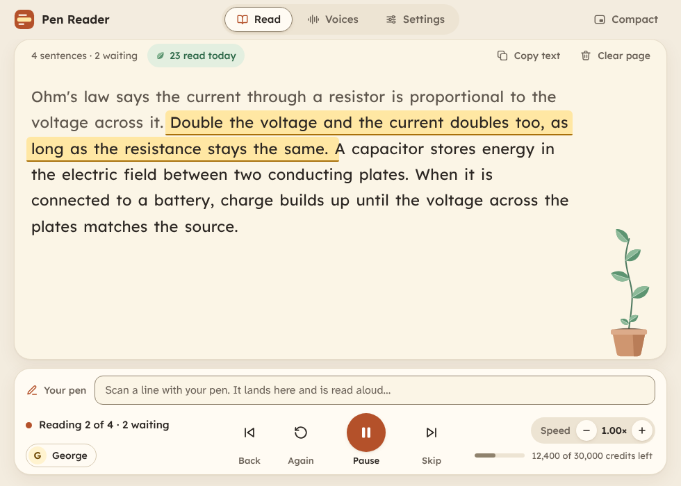
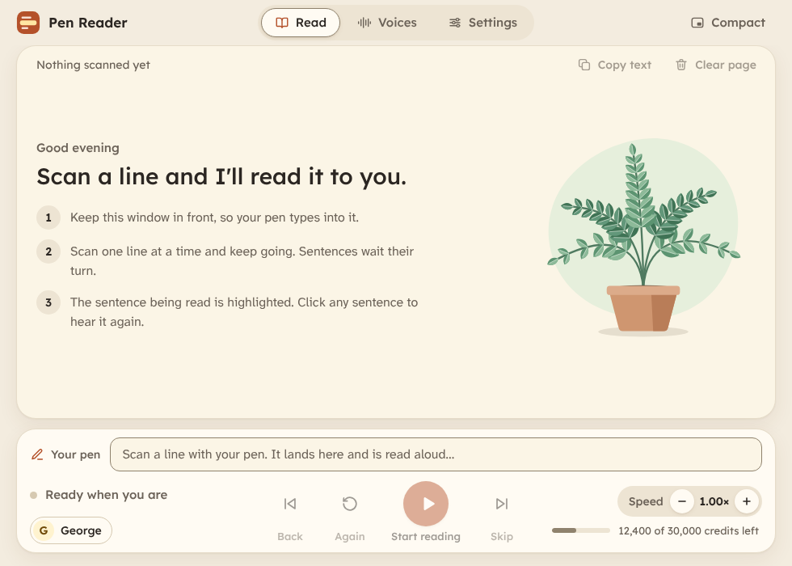
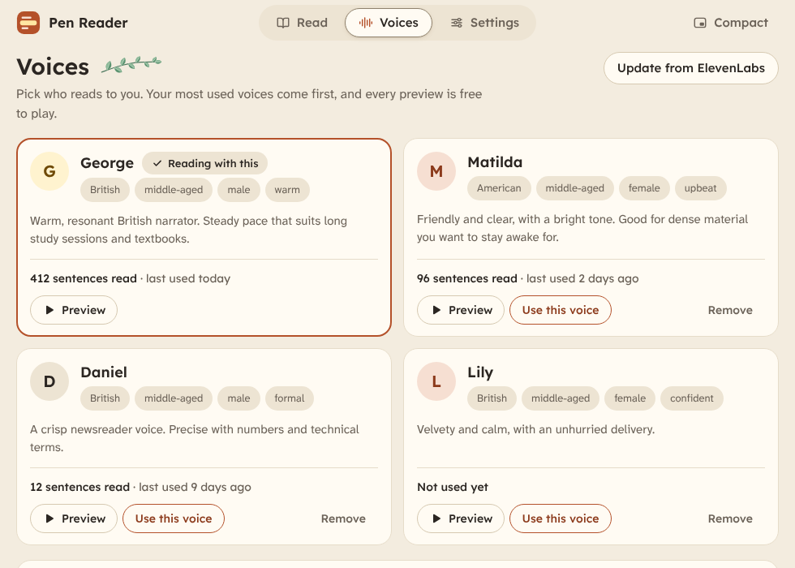
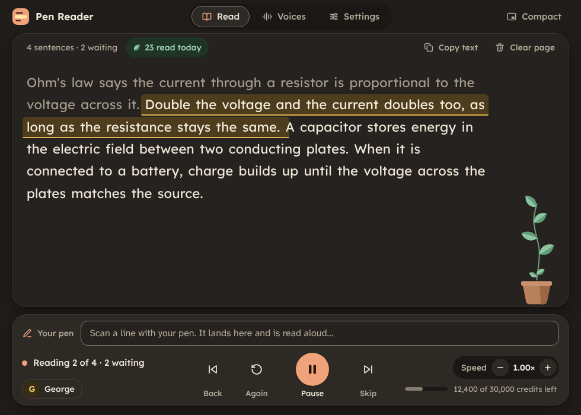
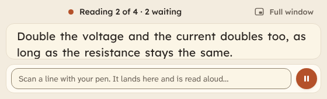

# Pen Reader

Scan a printed line with a reading pen and hear it read aloud in a natural voice. Keep scanning while it reads: sentences wait their turn, and a sentence that spans two scans is joined before it is spoken.

Pen Reader is a small Windows app for people who find listening easier than reading print, including dyslexic readers. Most reading pens speak in a robotic voice and stop between lines. Pen Reader uses ElevenLabs voices instead and reads continuously, so your eyes can stay on the book.

## Download

**[Download PenReader-Setup.exe from the latest release](https://github.com/Thelaw247/Pen-Reader-releases/releases/latest)** and run it.

It installs Pen Reader for your Windows account (no administrator password), adds it to the Start menu, and can put a shortcut on the desktop. Nothing else needs installing.

The installer is not code-signed, so Windows SmartScreen may say it is from an unknown publisher: choose **More info**, then **Run anyway**. On PCs with Smart App Control switched on, unsigned apps are blocked outright.

## What you need

- Windows 10 or 11.
- An ElevenLabs account and API key. The free plan works for trying it out. Create a key under **Developers > API Keys**. If you restrict the key, give it **Text to Speech: Access**, **Voices: Read** and **User: Read**.
- A scanning pen that types into the active window. Pen Reader was built with a PenPower WorldPenScan Go and its Windows software. Any pen or tool that types text like a keyboard should work, and you can also type or paste text yourself.

The first time you open it, paste your API key and press **Test voice**. A voice is filled in for you; you can pick another under **Voices** later.

## What it does

- **Reads continuously.** Scans join a queue while the current sentence is still being spoken.
- **Reads whole sentences.** Printed lines end mid-sentence. Pen Reader joins them, and rejoins words hyphenated across lines, so the voice sounds natural.
- **Shows where you are.** The sentence being read is highlighted. Click any sentence to hear it again.
- **Needs no Enter key.** Anything the pen types is picked up by itself.
- **Lets you choose the voice.** Your ElevenLabs voices are listed with descriptions and free previews, most used first.
- **Is comfortable to read.** A cream page, dark (not black) text, generous spacing, six highlight colours, three fonts, adjustable size, and a warm dark theme.
- **Tracks your credits.** It shows your ElevenLabs balance and counts what it has spent itself. Sentences you have already heard are saved on your computer, so hearing them again is free.
- **Has a compact strip** that stays on top of other windows, beside your book.
- **Grows a plant.** A vine beside the page gains a leaf for every five new sentences you read that day. You can hide it.

| Empty page | Voices |
| --- | --- |
|  |  |

| Evening theme | Compact strip |
| --- | --- |
|  |  |

## Use

1. Open your pen's scanning software and Pen Reader.
2. Click the Pen Reader window so it is in front. The pen types into whichever window is active.
3. Scan a line. Keep going while it reads.

| Shortcut | Does |
| --- | --- |
| Ctrl + Space | Pause or resume |
| Ctrl + Left | Back one sentence |
| Ctrl + R | Read this sentence again |
| Ctrl + Right | Skip this sentence |
| Ctrl + Up / Down | Faster / slower |
| Ctrl + M | Compact strip that stays on top |
| Ctrl + , | Settings |
| Ctrl + Shift + Backspace | Clear the page (asks first) |

Every shortcut uses Ctrl, so text from the pen can never set one off.

## Your key and your privacy

- Your API key is stored in Windows Credential Manager. It is never written to a file.
- The text you scan is sent to ElevenLabs to be turned into speech. Nothing is sent anywhere else, and there is no analytics or telemetry.
- Settings live in `%APPDATA%\PenReader\settings.json`. Saved audio lives in `%LOCALAPPDATA%\PenReader\cache` and can be cleared in Settings.
- ElevenLabs charges credits per character. Pen Reader shows what each session has used.

## If something goes wrong

| Problem | Try |
| --- | --- |
| The window doesn't open | Errors are written to `penreader.log` in `%LOCALAPPDATA%\PenReader`. |
| Nothing is read when you scan | Read the status line beside the play button. If it says "Click this window so your pen types here", another window was in front. |
| The credit meter is missing | Your API key is not allowed to read your balance. Edit the key in ElevenLabs and turn on **User: Read**. Pen Reader still counts what it spends. |
| The voice list is empty | Turn on **Voices: Read** for the key, or add a voice by pasting its ID. |
| No sound | Pen Reader uses the Windows default output device. |
| The first word is clipped on Bluetooth earbuds | That is the earbuds waking up. Pen Reader already sends a quarter-second of silence first. |

Found a bug or have an idea? [Open an issue](https://github.com/Thelaw247/Pen-Reader-releases/issues).

## About

Pen Reader is free to download and use. This repository holds the releases only; the source code is kept private.

Fonts: Lexend and Atkinson Hyperlegible Next, both under the SIL Open Font License.

Pen Reader is an independent project. It is not affiliated with or endorsed by ElevenLabs or PenPower. Using it requires your own ElevenLabs account and is subject to their terms.
